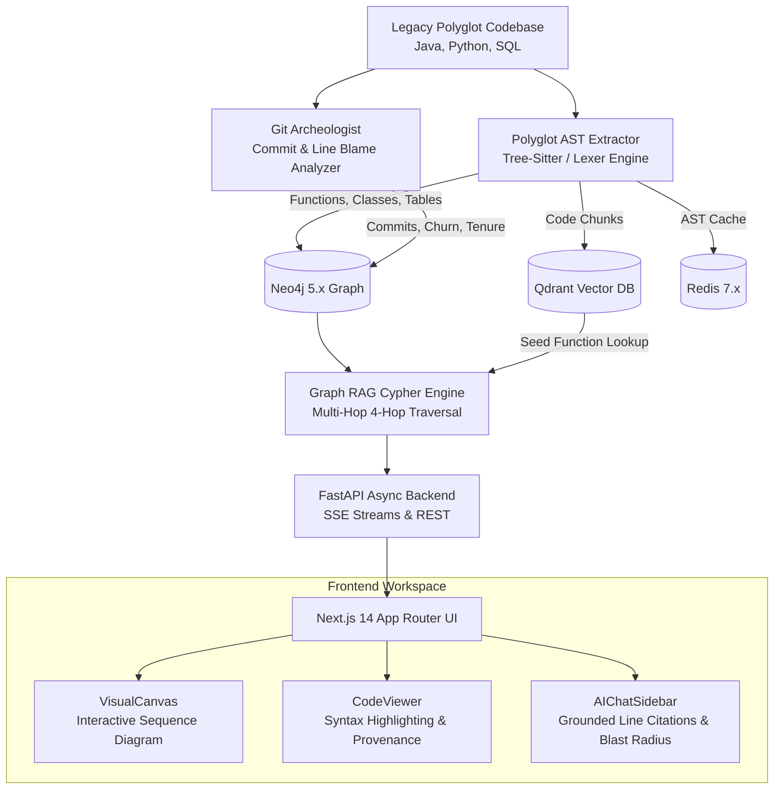

# Archaeo-Code: Enterprise Legacy Infrastructure & Code Archeology Platform

> **Reverse-engineer legacy codebases and distributed monoliths without breaking production.**

Archaeo-Code parses polyglot ASTs (Tree-Sitter for Java, Python, and SQL), extracts Git commit and blame history, indexes code entities into a Neo4j Knowledge Graph, and surfaces execution flows through an interactive sequence diagram canvas and a grounded AI chat sidebar.

---

## 1. System Architecture



---

## 2. Key Capabilities

### 🔍 Polyglot AST Extractor (`backend/app/parsers/ast_parser.py`)
- Extracts `Function`, `Class`, `Module`, `DatabaseTable`, and `DatabaseQuery` nodes.
- Maps `(:Function)-[:CALLS]->(:Function)` and `(:Function)-[:MUTATES_TABLE]->(:DatabaseTable)`.
- **Specialized Legacy Detection**:
  - Detects legacy RPC endpoints (`@Remote`, `@RpcMethod`, `@RestController`, SOAP, XML-RPC, Thrift).
  - Detects Stored Procedure calls (`CALL sp_...`, `CallableStatement`).
  - Identifies raw SQL DML queries (`INSERT`, `UPDATE`, `DELETE`) embedded in Java strings or Python queries.

### 📜 Git Archeologist (`backend/app/parsers/git_archeologist.py`)
- Maps line-by-line provenance to AST function scopes.
- Identifies **Code Churn**, **Bus Factor**, and **Legacy Risk**:
  - `CRITICAL_LEGACY`: Code untouched for > 5 years, written by retired authors, mutates core financial ledgers without transactional locks.
  - `HIGH_CHURN`: Fragile logic edited by > 4 authors across emergency hotfixes.

### 🧠 Cypher Graph RAG Engine (`backend/app/rag/graph_rag.py`)
- Executes multi-hop Cypher queries up to 4 hops deep.
- Prunes boilerplate framework noise (getters/setters, loggers, equals/hashCode).
- Calculates **Downstream & Upstream Blast Radius**:
  - Exact list of callers that break if a function changes.
  - Database tables impacted.
  - Network and RPC boundaries crossed.

### ⚡ Interactive Next.js Frontend (`frontend/src/`)
- **`VisualCanvas.tsx`**: Dynamic execution sequence diagram displaying actors across the top, activation lifelines, step-by-step playback with scrubber, and pulsing tokens for RPC boundaries.
- **`CodeViewer.tsx`**: Syntax-highlighted code with line numbers, Git blame gutter, and automatic scrolling to selected execution steps.
- **`AIChatSidebar.tsx`**: Streaming AI drawer with Blast Radius Radar and **interactive line citations** (e.g. clicking `[OrderProcessor.java:16]` highlights the step and jumps to the exact line).

---

## 3. Directory Layout

```
├── backend/
│   ├── app/
│   │   ├── api/
│   │   │   ├── router.py             # Master API router
│   │   │   ├── ingestion.py          # /api/v1/ingest & /sample-repo
│   │   │   └── explain.py            # /api/v1/explain & /call-chain
│   │   ├── core/
│   │   │   ├── config.py             # Settings (Neo4j, Qdrant, LLM)
│   │   │   └── neo4j_client.py       # Async Neo4j driver + In-Memory Fallback
│   │   ├── parsers/
│   │   │   ├── ast_parser.py         # Tree-Sitter polyglot AST extractor
│   │   │   └── git_archeologist.py   # Git commit & blameline history
│   │   └── rag/
│   │       ├── graph_rag.py          # Cypher 4-hop call-chain engine
│   │       └── prompt_templates.py   # Strict line citation prompts
│   ├── main.py                       # FastAPI entry point
│   ├── requirements.txt
│   └── sample_legacy_repo/           # Out-of-the-box Banking Monolith demo
├── frontend/
│   ├── src/
│   │   ├── app/
│   │   │   ├── page.tsx              # Executive Dashboard Landing
│   │   │   ├── layout.tsx            # Global Layout & Dark Theme
│   │   │   └── archeology/
│   │   │       └── page.tsx          # Main Visual Canvas & Chat Workspace
│   │   ├── components/
│   │   │   ├── VisualCanvas.tsx      # D3/Canvas interactive sequence diagram
│   │   │   ├── CodeViewer.tsx        # Line provenance & syntax viewer
│   │   │   └── AIChatSidebar.tsx     # Grounded AI explanation drawer
│   │   └── lib/
│   │       └── api.ts                # TypeScript client & fallback data
│   ├── package.json
│   ├── tsconfig.json
│   └── tailwind.config.js
└── docker-compose.yml                # Neo4j 5.x, Qdrant, Redis 7.x
```

---

## 4. Quickstart Guide

### Step 1: Start Infrastructure (Docker)
```bash
docker compose up -d
```
Services exposed:
- Neo4j Browser: [http://localhost:7474](http://localhost:7474) (User: `neo4j`, Password: `archaeocode2024`)
- Qdrant Vector DB: [http://localhost:6333](http://localhost:6333)
- Redis Cache: [http://localhost:6379](http://localhost:6379)

### Step 2: Run Backend
```bash
cd backend
pip install -r requirements.txt
python main.py
```
Backend API will be running at [http://localhost:8000](http://localhost:8000). Interactive Swagger docs available at [http://localhost:8000/docs](http://localhost:8000/docs).

### Step 3: Run Frontend
```bash
cd frontend
npm install
npm run dev
```
Open [http://localhost:3000](http://localhost:3000) to view the landing page or [http://localhost:3000/archeology](http://localhost:3000/archeology) to dive directly into the archeology canvas.
